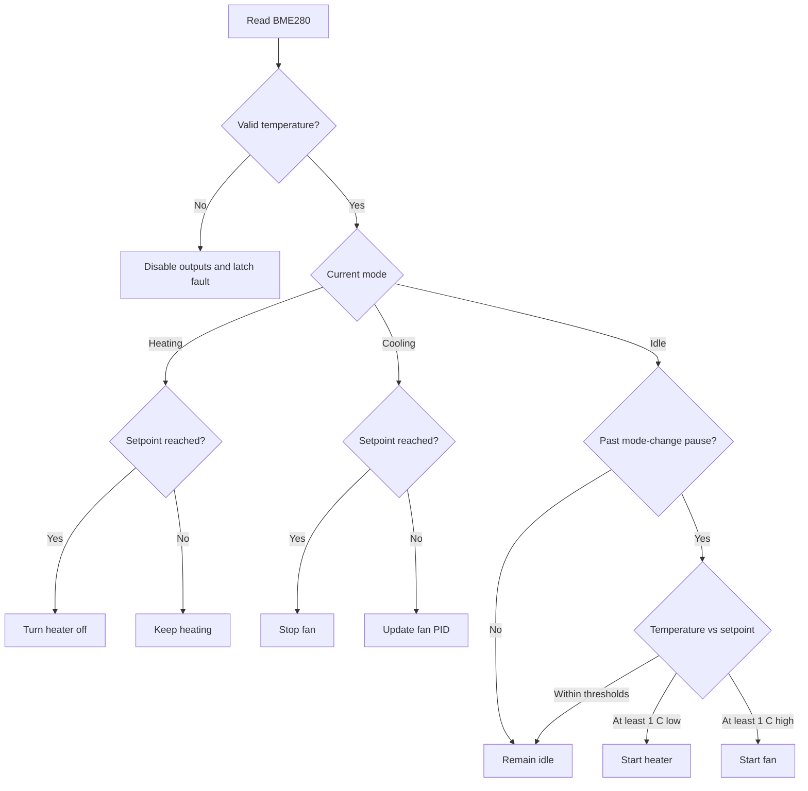

# Firmware design

The firmware runs in a single main loop with tick-based sampling and display refresh. The BME280 is polled approximately once per second; buttons are debounced in software.

## State machine

Three modes are used: `MODE_IDLE`, `MODE_HEATING` and `MODE_COOLING`.



With a 25 °C setpoint, heating starts at or below 24 °C and stops at 25 °C; cooling starts at or above 26 °C and stops at 25 °C. Starting a new mode is blocked during the three-second pause following an active mode.

These are **separate start and stop thresholds**, rather than a conventional ±1 °C symmetric hysteresis across both sides of the setpoint.

## PID cooling

The cooling error is `measured_temp - setpoint` (°C). The commanded duty is approximately:

```text
duty = 40 + Kp*error + Ki*integral + Kd*filtered_temperature_rate
```

The loop clamps active duty to 40–100%. The derivative estimate uses a simple first-order filter. Conditional integration limits integral windup when the output saturates. The controller is reset when the state exits cooling.

Current gains are `Kp = 15`, `Ki = 0.08` and `Kd = 6`. These are starting values and should be tuned against a recorded temperature response.

The heater is intentionally **on/off** rather than PID-controlled.

## Configuration

Edit the `#define` constants near the start of `Core/Src/main.c`:

| Constant | Default | Meaning |
| --- | --- | --- |
| `SETPOINT_DEFAULT_X2` | `50` | Start setpoint, in 0.5 °C units |
| `SETPOINT_MIN_X2` / `MAX_X2` | `20` / `80` | 10–40 °C range |
| `SETPOINT_STEP_X2` | `1` | 0.5 °C per press |
| `HEAT_ON_DELTA_C` | `1.0f` | Heating starts below setpoint by 1 °C |
| `COOL_ON_DELTA_C` | `1.0f` | Cooling starts above setpoint by 1 °C |
| `HEAT_OFF_DELTA_C` / `COOL_OFF_DELTA_C` | `0.0f` | Stop at setpoint |
| `PID_KP`, `PID_KI`, `PID_KD` | `15`, `0.08`, `6` | Cooling PID gains |
| `FAN_MIN_ACTIVE_PCT` | `40U` | Minimum fan duty while cooling |
| `FAN_USE_PID` | `1U` | `1` for PID, `0` for fixed PWM |
| `FAN_FIXED_PWM_PCT` | `70U` | Fixed PWM test value |
| `FAN_SELFTEST_ENABLED` | `0U` | Startup fan test off by default |
| `HEATER_MAX_SENSOR_C` | `35.0f` | Lock heater after sensor reaches limit |
| `MODE_CHANGE_PAUSE_MS` | `3000U` | Output-off pause after a mode |

## Failure handling

- BME280 I²C failure or invalid/stale temperature → stop outputs and latch sensor fault.
- BME280 temperature at or above 35 °C → lock out further heating until restart.
- Both buttons held for 1.2 seconds → emergency stop until restart.
- Heating and cooling are mutually exclusive in software.

These measures do **not** provide an independent thermal cutout. The BME280 is not attached to the heater resistor, and a stalled MCU or disconnected GPIO may cause different electrical behavior. Use a physical power disconnect during tests.
